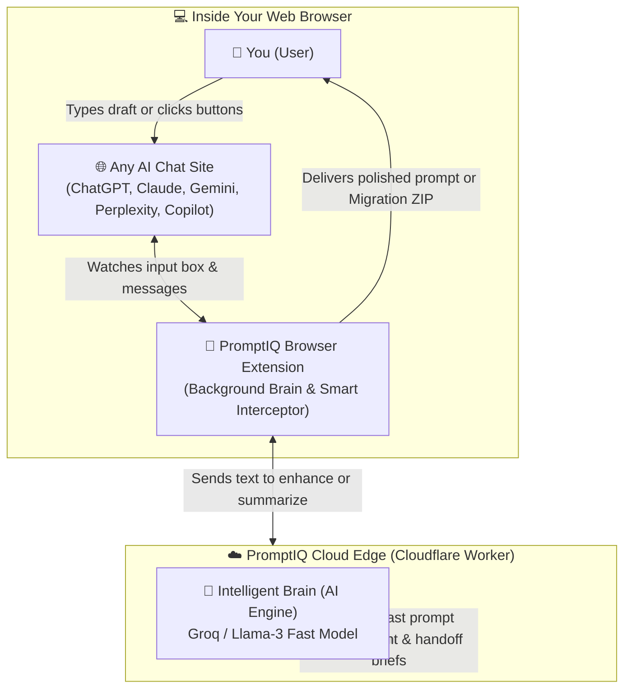
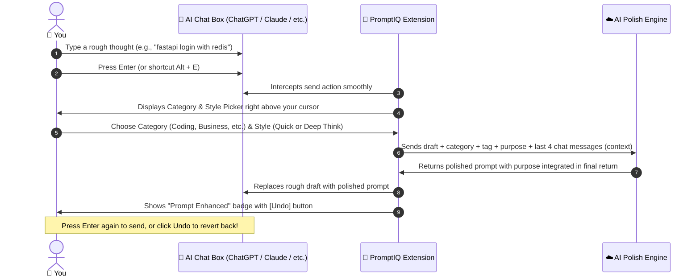
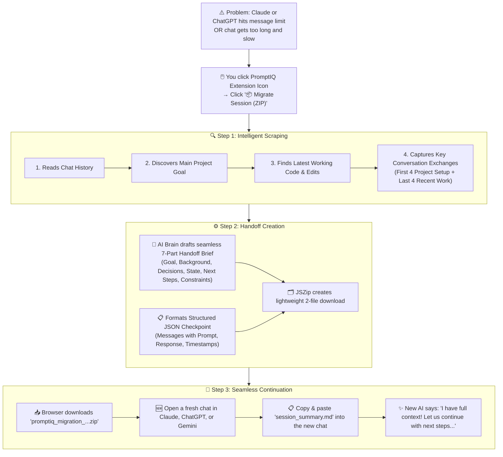
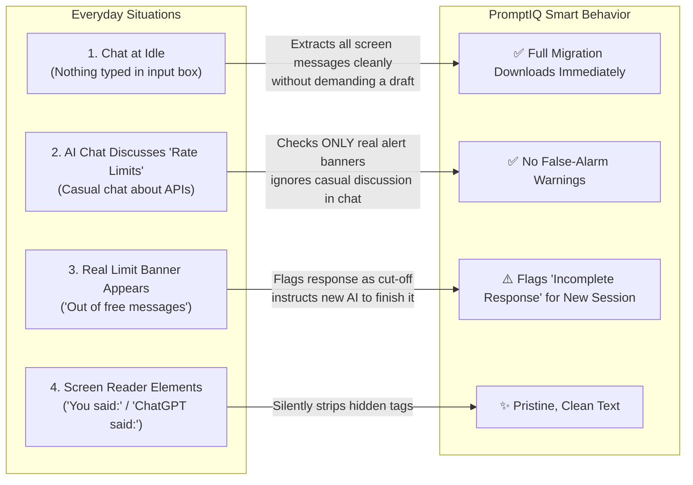

# 🧠 PromptIQ — Project Summary & Complete Workflow Guide

> **Your Universal AI Co-Pilot & Seamless Session Migration Assistant**  
> *Transform rough thoughts into expert-level prompts, and move your conversations across any AI platform with zero lost context.*

---

## 📖 1. What is PromptIQ? (The Big Picture)

When working with modern AI assistants like **ChatGPT**, **Claude**, **Gemini**, **Perplexity**, or **Copilot**, users constantly run into two massive roadblocks:

1. **The "Blank Box" Problem (Garbage in, Garbage out):**  
   Typing a quick, informal thought like *"make me a login page"* usually results in a generic, incomplete answer. Great results require role definition, constraints, best practices, and formatting requirements — things people rarely have the time or energy to type out every time.
2. **The "Limit Reached" & Walled Garden Problem:**  
   You are 30 messages deep into designing a complex project or fixing a stubborn bug, and suddenly:
   - *"You've reached your free message limit. Resets in 4 hours."*
   - Or the conversation gets so long the AI becomes slow and forgets earlier instructions.
   - Or you want to take your work from Claude over to ChatGPT or Gemini to get a second opinion.  
   **Starting over in a new window is painful.** You have to manually re-explain your entire project, constraints, and progress from scratch.

### 🌟 How PromptIQ Solves Both:
- 🪄 **Instant Prompt Polish (The Intelligent Co-Pilot):** Automatically intercepts your draft, asks how you want it framed (Coding, Creative, Business, Quick Answer, or Deep Thinking), and turns your 5-word draft into an expert prompt right inside the input box — with a 1-click **Undo** button if you prefer your original wording.
- 📦 **Session Migration (The Digital Moving Truck):** One click packages your entire conversation — past goals, working code, decisions made, and exact chat pairs — into a lightweight **2-file ZIP**. You drop or paste it into a brand-new chat (on Claude, ChatGPT, or Gemini), and the new AI immediately continues where the old one stopped.

---

## 🗺️ 2. High-Level System Architecture

Here is how all the pieces work together in plain, non-technical terms:

### The 3 Core Moving Parts:
1. **The Browser Extension:** Lives quietly in your browser. It knows the exact layout of ChatGPT, Claude, Gemini, Perplexity, and Copilot.
2. **The Cloud Brain (Cloudflare Worker):** A lightning-fast server running on the global edge network. It takes your rough thoughts and drafts expert prompts in less than a second.
3. **The User Controls (Toolbar & Popup):** Simple menus that let you pick prompt categories, trigger Alt+E shortcuts, or hit "Migrate Session (ZIP)".

---

## 🪄 3. Feature 1: Prompt Enhancement Workflow

How PromptIQ transforms your ideas before the AI sees them:

### Step-by-Step Walkthrough:
1. **You type normally:** Write whatever is on your mind into the input box.
2. **Smooth Interception:** When you press Enter (or press `Alt + E`), PromptIQ pauses the message from sending immediately.
3. **Pick Your Goal:** A sleek, friendly chip appears above your input box offering:
   - 💻 **Coding:** Adds architecture, error-handling, clean code principles, and modern framework conventions.
   - ✍️ **Creative:** Enhances tone, imagery, and storytelling depth.
   - 💼 **Business:** Focuses on actionable strategy, executive clarity, and ROI.
   - ⚡ **Quick Mode:** Tells the AI to skip polite introductions and deliver the direct answer immediately.
   - 🧠 **Think Mode:** Tells the AI to ask you clarifying questions first before writing code.
4. **Instant Polish:** In under 1 second, your input box updates with the polished version.
5. **Always in Control:** Don't like the new prompt? Click **Undo** (or press Escape), and your exact original text is restored instantly.

---

## 📦 4. Feature 2: Session Migration Workflow (Moving Between AI Chats)

When an AI hits its message limit, or when a chat gets too long and laggy, Session Migration saves the day:

---

## 📂 5. What is Inside the Migration ZIP?

The migration ZIP is intentionally kept clean, fast, and clutter-free — containing strictly **two essential files**:

| File Name | Purpose | What It Contains | How to Use It |
| :--- | :--- | :--- | :--- |
| **`session_summary.md`** | **The Executive Handoff Brief** | A clean, human-readable summary written specifically for a new AI to read. It tells the new AI:  1. What the overall project goal is. 2. Key facts and background. 3. Architectural decisions already agreed upon. 4. The current state and working code. 5. Exactly what task is pending next. 6. Things to avoid. | **Simply copy the text and paste it into your new chat window.** The new AI immediately knows everything. |
| **`session_continuation.json`** | **The Structured Technical Checkpoint** | A clean JSON record containing the first 4 setup exchanges and the last 4 recent exchanges, complete with prompts, AI responses, and timestamps. | For backups, programmatic reload, or automated toolchains. |

---

## ⚡ 6. Smart Edge Cases: How PromptIQ Handles Real-World Chat Quirks

PromptIQ was engineered to adapt to messy, real-world web environments:

1. **At Idle (Nothing in Input Box):** You don't have to type anything in the chat box to migrate. PromptIQ automatically reads your chat history directly from the page.
2. **No False-Alarm Warnings:** If you and the AI are discussing *"how to build an API rate limiter"*, PromptIQ won't confuse that with a real ChatGPT usage block. It only flags cutoffs if an actual system alert banner is active.
3. **Screen-Reader Cleanups:** Hidden web tags like `"You said:"` or `"ChatGPT said:"` are automatically cleaned up so your exported files are crisp and readable.
4. **1-Click Safety:** Enhancement never traps you — pressing Enter again sends the enhanced prompt, while clicking **Undo** or pressing `Esc` brings your original words back immediately.

---

## 🌐 7. Supported Platforms Matrix

PromptIQ automatically identifies which site you are on and adapts its behavior instantly:

| Platform | Domain | Prompt Enhancement | Session Migration | Auto-Detects Limits |
| :---: | :---: | :---: | :---: | :---: |
| **OpenAI ChatGPT** | `chatgpt.com`, `chat.openai.com` | ✅ Yes | ✅ Yes (Full 2-File ZIP) | ✅ Yes |
| **Anthropic Claude** | `claude.ai` | ✅ Yes | ✅ Yes (Full 2-File ZIP) | ✅ Yes |
| **Google Gemini** | `gemini.google.com` | ✅ Yes | ✅ Yes (Full 2-File ZIP) | ✅ Yes |
| **Perplexity AI** | `perplexity.ai` | ✅ Yes | ✅ Yes (Full 2-File ZIP) | ✅ Yes |
| **Microsoft Copilot** | `copilot.microsoft.com` | ✅ Yes | ✅ Yes (Full 2-File ZIP) | ✅ Yes |

---

## 🎯 8. Summary in One Sentence

> **PromptIQ makes your AI prompts 10x better before you hit send, and lets you transport an entire conversation from any AI to any other AI in 5 seconds flat.**
