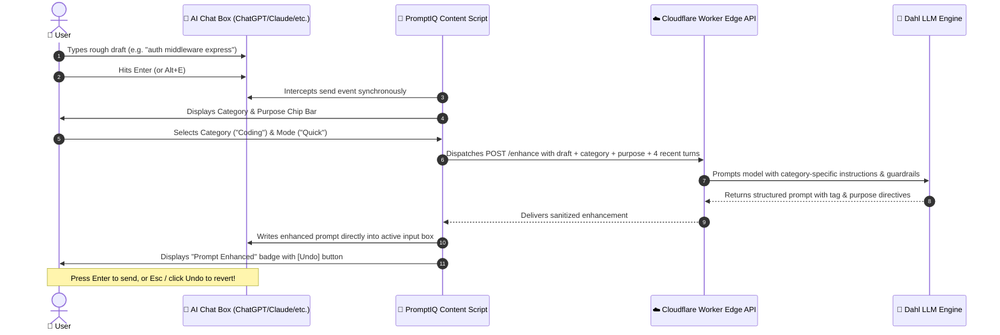
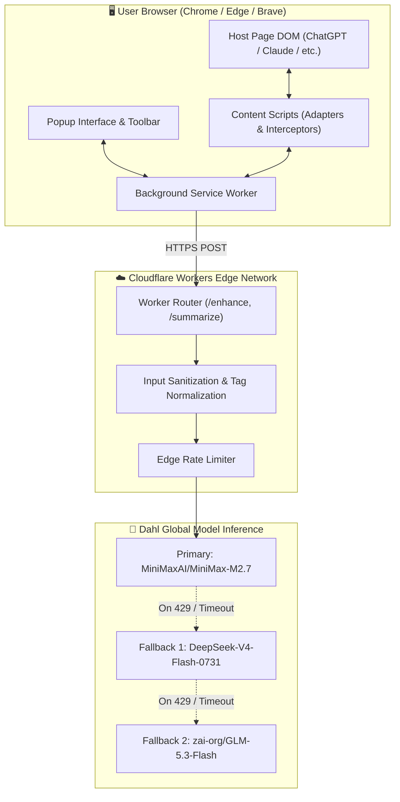

# 🧠 PromptIQ — Comprehensive Project Report

> **Write Better Prompts. Never Lose Your Flow.**  
> *A Universal Browser Extension for Intelligent Prompt Enhancement and Cross-Platform Session Migration.*

---

## 👥 Project Team & Metadata

| Role | Name | Details |
| :--- | :--- | :--- |
| **Team Leader** | **Abhishek Bansal** | Project Architecture, System Integration & Strategy |
| **Team Member** | **Dhruv Agarwal** | Extension Architecture, Cloudflare Worker Edge & API Integration |
| **Team Member** | **Dhruv Gupta** | DOM Adapters, Multi-Platform Scraping & Content Scripts |
| **Team Member** | **Aman Sharma** | Quality Assurance, E2E Test Suites & Security Guardrails |
| **Project Repository** | `PromptIQ fw fw` | Manifest V3 Browser Extension + Cloudflare Edge / Node.js Backend |
| **Report Version** | **v4.0 (Post-Refactor Final)** | Reflects complete removal of legacy artifacts & addition of 2-file migration standard |

---

## 📑 Table of Contents

1. [Executive Summary](#1-executive-summary)
2. [Problem Statement & Background](#2-problem-statement--background)
3. [Architecture Evolution: What Was Removed & What Is New](#3-architecture-evolution-what-was-removed--what-is-new)
4. [Core Feature 1: Intelligent Prompt Enhancement](#4-core-feature-1-intelligent-prompt-enhancement)
5. [Core Feature 2: Universal Session Migration (2-File Standard)](#5-core-feature-2-universal-session-migration-2-file-standard)
6. [Supported Platforms & Adapter Mechanics](#6-supported-platforms--adapter-mechanics)
7. [System Architecture & Data Flow](#7-system-architecture--data-flow)
8. [Edge Cases, Resilience & Safety Guardrails](#8-edge-cases-resilience--safety-guardrails)
9. [Verification, Quality Assurance & Test Coverage](#9-verification-quality-assurance--test-coverage)
10. [Expected Impact & Future Roadmap](#10-expected-impact--future-roadmap)

---

## 1. Executive Summary

As large language models (LLMs) like **ChatGPT**, **Claude**, **Gemini**, **Perplexity**, and **Microsoft Copilot** become daily drivers for developers, researchers, and writers, two systemic bottlenecks persistently break user momentum:

1. **The Prompting Gap:** Novice and intermediate users struggle to provide the context, role definition, edge cases, and formatting instructions needed to get optimal responses on the first try.
2. **The Walled-Garden Rate Limit:** Conversations reach platform usage limits or encounter performance degradation in long threads. Users are forced to abandon their workflow or manually copy/paste history into a new chat, losing past context and working state.

**PromptIQ** solves both challenges within a single, lightweight Manifest V3 browser extension:
- **Intelligent Prompt Polish:** Automatically intercepts rough drafts, categorizes intent (Coding, Learning, Write, Researching, Life Stuff), applies purpose modes (Quick vs. Think), enriches the prompt with the last 4 messages of active context, and replaces the draft with an expert-level structured prompt in place—complete with a 1-click **Undo** safeguard.
- **Universal Session Migration:** Packages the entire conversation into a clean, standardized **2-file ZIP** (`session_summary.md` and `session_continuation.json`). The user pastes the AI handoff brief into a new chat on *any* AI platform, and the new model immediately resumes the work without losing architectural decisions, working code, or open questions.

---

## 2. Problem Statement & Background

```
┌─────────────────────────────────────────────────────────────────────────────┐
│                       THE TWO BREAKPOINTS IN AI CHAT                        │
└─────────────────────────────────────────────────────────────────────────────┘
  1. INPUT STAGE: The Prompting Gap
     User types: "fastapi login redis"
     AI returns: Generic snippet without JWT, error handling, or schema.
     Result: 4–6 follow-up turns wasted fixing basic expectations.

  2. WORKFLOW STAGE: The Rate-Limit & Token Wall
     User is 35 messages deep into designing an app.
     Alert: "You've reached your free message limit. Resets in 4 hours."
     Native Share Links: Platform-locked, full of conversational fluff, no handoff logic.
     Result: Broken workflow, lost context, abandoned momentum.
```

### Why Native Solutions Fall Short:
- **Native Share Links:** ChatGPT and Claude share links only work within their own platform. You cannot paste a Claude share link into ChatGPT or Gemini and expect it to resume cleanly.
- **Copying Raw History:** Pasting 30 raw conversation turns consumes massive context windows, wastes tokens, triggers rate limits faster, and confuses the model with outdated debugging discussions.
- **Prompt Template Libraries:** Static snippet extensions offer generic boilerplate that lacks awareness of the active conversation's state.

---

## 3. Architecture Evolution: What Was Removed & What Is New

During the iterative engineering of PromptIQ v4.0, major architectural refactoring was executed to eliminate bloat, improve reliability, and prioritize **Quality > Time**.

### 🗑️ What Was Removed (Deprecated Legacy Code)

| Deprecated Component | Reason for Removal | Former Location |
| :--- | :--- | :--- |
| **`artifacts/` Folder Generation** | Generating arbitrary PDFs, SVGs, and base64 PNGs overwhelmed the export package, created bloated ZIP files, and distracted target LLMs from the core technical context. | `extension/content/exporter.js` |
| **Local NES/Anchor Image Renderers** | Embedded canvas/SVG generators (`generateNesNewsAnchorSvg`, `svgToPngBase64`, `createMinimalPdf`) introduced unnecessary dependencies and brittle DOM conversions. | `exporter.js` |
| **Raw Media Blob Scraping** | Scraping every web image blob into the migration ZIP caused huge payload spikes and frequent memory exhaustion during long sessions. | `chatDom.js` |
| **Redundant Continuation Keys** | Legacy JSON structures contained overlapping fields (`turns`, `dialogue`, `rawLog`, `exchanges_v1`), confusing external parsers. | `exporter.js` |
| **"100% Local / No-Server" Limitation** | The initial prototype attempted client-only regex summarization. Complex multi-turn conversations cannot be properly synthesized without an LLM; regex string concatenation produced shallow, repetitive handoffs. | Architecture concept |

---

### ✨ What Is New in PromptIQ v4.0

| New Feature | Technical Implementation | Benefit |
| :--- | :--- | :--- |
| **Streamlined 2-File Migration Standard** | Strictly generates `session_summary.md` and `session_continuation.json`. No folders, no media clutter. | Ultra-clean, universal package consumable by humans and any LLM. |
| **7-Part Executive Handoff Brief** | AI-generated summary structured with: Goal, Background, Decisions Made, Current State (verbatim code), Open Questions, Preferences, and Things to Avoid. | New AI understands the exact project trajectory in a single paste. |
| **4+4 Continuation Checkpoint** | Extracts the **first 4 setup exchanges** (foundational intent) and **last 4 recent exchanges** (active state), trimming intermediate fluff. | Preserves critical anchors while saving thousands of context tokens. |
| **Dual Backend Architecture** | Live Cloudflare Worker Edge (`workers.dev`) with multi-model fallback (`MiniMax-M2.7`, `DeepSeek-V4-Flash-0731`, `GLM-5.3-Flash`) + local Node.js Express server. | Sub-second edge inference globally, high availability, zero downtime. |
| **Purpose-Driven Enhancements** | Added **Quick Mode** (direct, minimal, no conversational filler) and **Think Mode** (clarifying questions first before coding). | Adapts prompt structure to user's immediate cognitive goal. |
| **Universal DOM Adapters (5 Sites)** | Robust adapters for ChatGPT, Claude, Gemini, Perplexity, and Copilot with shadow-DOM piercing and modern DOM selectors. | Seamless cross-platform operation on any major AI site. |
| **Interruption & Cutoff Detection** | Flags incomplete assistant responses caused by rate limits or stream drops, directing the new AI to complete the unfinished output. | Rescues half-generated code blocks and truncated explanations. |

---

## 4. Core Feature 1: Intelligent Prompt Enhancement

PromptIQ enhances user prompts before they are transmitted to the host platform, transforming ambiguous thoughts into production-grade prompts.



### Key Technical Aspects:
1. **Synchronous Interception:** Content scripts use event capturing on `keydown` (`Enter`) and `click`/`mousedown` on send buttons. A cached storage state allows synchronous `preventDefault()` without waiting for async storage roundtrips.
2. **Category Classification & Tagging:**
   - `[Coding]`: Focuses on architecture, edge cases, error handling, and clean code.
   - `[Learning]`: Focuses on first principles, analogies, and step-by-step breakdowns.
   - `[Write]`: Focuses on tone, grammar, style, audience adaptation, and clarity.
   - `[Researching]`: Focuses on requesting citations, varied perspectives, and factual accuracy.
   - `[Life Stuff]`: Focuses on casual, empathetic, and actionable advice.
   - `[Other]`: General clarity and context enhancement.
3. **Purpose Modes:**
   - **Quick Mode:** Integrates `(Provide the fastest, most concise minimal solution immediately.)`
   - **Think Mode:** Integrates `(Ask relentless questions about everything you need context on before answering.)`
4. **Context Injection:** Extracts the last 4 conversation messages from the active DOM, giving the model situational awareness of ongoing work.
5. **1-Click Undo Safeguard:** If the enhanced prompt does not match the user's intent, pressing `Esc` or clicking **Undo** restores the original text instantly.

---

## 5. Core Feature 2: Universal Session Migration (2-File Standard)

When a session reaches a rate limit or context degradation, clicking **"📦 Migrate Session (ZIP)"** in the popup creates a clean, 2-file migration package.

```
📁 promptiq_migration_[site]_[chatId]_[timestamp].zip
│
├── 📄 session_summary.md           <-- The Executive Handoff Brief (for the AI)
└── 📄 session_continuation.json    <-- The Technical Checkpoint (for data tools)
```

### File 1: `session_summary.md` (The Handoff Brief)
Written specifically for a fresh AI session to consume with zero prior context. It begins with the standardized directive:
> *"This is a summary of a previous conversation. Use it as context and continue from where we left off."*

It follows a strict **7-Part Framework**:
1. **Goal:** The ultimate objective of the conversation in 2–3 concise sentences.
2. **Background and Context:** Technical constraints, libraries, target audience, and environment details.
3. **Decisions Made:** Architectural choices and rejected alternatives (preventing the new AI from re-litigating settled discussions).
4. **Current State:** Working code blocks, completed files, and active drafts included verbatim.
5. **Open Questions & Next Steps:** Exactly what remains pending and what needs immediate implementation.
6. **Preferences:** Formatting, style, and communication preferences established by the user.
7. **Things to Avoid:** Anti-patterns, failed approaches, or topics explicitly ruled out.

### File 2: `session_continuation.json` (The Structured Checkpoint)
Contains structured metadata and message pairs formatted for automated re-import or programmatic pipelines:
```json
{
  "chat_id": "6ad60c8f-9a84-83ec-93ce-886a3c5e10a8",
  "adapter": "chatgpt",
  "exported_at": "2026-10-22T03:48:20.123Z",
  "total_pairs_count": 28,
  "exported_pairs_count": 8,
  "session_continuation": [
    {
      "prompt_no": 1,
      "prompt": "Build a FastAPI backend with Redis auth",
      "response": "Here is the architectural overview...",
      "timestamp": "2026-10-22T03:00:10.000Z"
    },
    {
      "prompt_no": 28,
      "prompt": "Add rate limiting middleware",
      "response": "Here is the Redis token-bucket middleware...",
      "timestamp": "2026-10-22T03:47:05.000Z"
    }
  ]
}
```
- **Upper 4 Pairs (1–4):** Captures initial project setup, dependencies, and requirements.
- **Lower 4 Pairs (N-3 to N):** Captures the latest working code, recent modifications, and open questions.
- **Intermediate Turns (5 to N-4):** Filtered out to avoid token waste, summarized by the executive brief instead.

---

## 6. Supported Platforms & Adapter Mechanics

PromptIQ employs a modular adapter architecture (`extension/content/adapters/`) allowing platform-specific DOM parsing without contaminating core application logic.

| Platform | Hostname Regex | Input Selector | Message Role Parsing |
| :--- | :--- | :--- | :--- |
| **OpenAI ChatGPT** | `/(^\|\.)(chatgpt\.com\|chat\.openai\.com)$/i` | `#prompt-textarea`, `div[contenteditable="true"]` | `data-message-author-role`, `.markdown`, `.agent-turn` |
| **Anthropic Claude** | `/(^\|\.)claude\.ai$/i` | `div.ProseMirror[contenteditable="true"]` | `[data-testid="user-message"]`, `.font-claude-response` |
| **Google Gemini** | `/(^\|\.)gemini\.google\.com$/i` | `rich-textarea .ql-editor` | `<user-query>`, `<model-response>` |
| **Perplexity AI** | `/(^\|\.)perplexity\.ai$/i` | `textarea`, `div[role="textbox"]` | `[class~="group/query"]`, `[id^="markdown-content-"]` |
| **Microsoft Copilot** | `/(^\|\.)copilot\.microsoft\.com$/i` | Shadow DOM `textarea#userInput` | `[data-content="user-message"]`, `[data-content="ai-message"]` |

### Platform-Specific Highlights:
- **Shadow-DOM Piercing (Copilot):** Uses a recursive DOM crawler (`deepQuerySelector`) to locate message trees encapsulated inside web components and closed/open shadow roots.
- **Modern ChatGPT DOM Extraction:** Supports both legacy `data-message-author-role` attributes and the modern article turn structure (`article[data-testid*="conversation-turn"]`).
- **Project URL Recognition (Claude):** Accurately captures chat identifiers across both standard routes (`/chat/<id>`) and Claude Team/Enterprise project workspaces (`/project/<proj_id>/chat/<id>`).

---

## 7. System Architecture & Data Flow



### Technology Stack Details:
- **Client:** Manifest V3, HTML5, CSS3, Vanilla ES2022 JavaScript, JSZip 3.10.
- **Edge Backend:** Cloudflare Workers (V8 isolates), zero cold-start, globally distributed.
- **Local Dev Server:** Node.js 20+, Express 4, Helmet security headers, CORS protection.
- **Inference Engine:** Dahl Inference API with automated multi-model fallback chain.
- **Privacy Model:** **Zero-Persistence**. No database, no user tracking, no query logging.

---

## 8. Edge Cases, Resilience & Safety Guardrails

### 1. Idle-State Migration
Users often want to migrate an existing conversation without typing a new prompt. PromptIQ's scraping engine reads directly from the message history container, allowing full migration even when the input box is completely empty.

### 2. Disambiguating Real Rate Limits from Chat Content
If a user and an AI are discussing how to implement rate limiting in software, naive extensions trigger false-alarm warning banners. PromptIQ only flags rate limits if an actual system-level alert banner element is rendered by the host application (e.g., `div[class*="banner"]` with phrase verification).

### 3. Screen-Reader Text Sanitization
Modern web AI interfaces inject hidden accessibility headings like `"You said:"` or `"ChatGPT said:"` for screen readers. PromptIQ automatically cleans these artifacts from user messages and assistant responses.

### 4. Code Block & Verbatim Preservation
During enhancement, prompt validation strictly verifies that any code snippets inside the original draft are preserved intact. Enhancements that truncate or alter user code are rejected by post-validation.

### 5. URL Sanitization Symmetry
The background worker sanitizes host endpoint URLs symmetrically, stripping trailing `/enhance`, `/summarize`, or `/health` paths to prevent route-mangling when custom local or remote backend addresses are configured.

---

## 9. Verification, Quality Assurance & Test Coverage

PromptIQ features an extensive automated test suite covering unit tests, backend route validation, and full Playwright browser end-to-end (E2E) flows.

```
======================================================================
                  PROMPTIQ TEST SUITE EXECUTION SUMMARY
======================================================================
  [PASS] test-migration-zip.js               20 / 20 passed
  [PASS] test-claude-artifacts-specific.js   32 / 32 passed
  [PASS] test-chatgpt-idle-modern-dom.js     16 / 16 passed
  [PASS] e2e.js (Full Extension Lifecycle)   20 / 20 passed
  [PASS] e2e2.js (Edge Cases & Reload)       13 / 13 passed
  [PASS] backend/test/ (Route & Prompt Unit) 10 / 10 passed
----------------------------------------------------------------------
  TOTAL TEST COUNT:                         111 / 111 PASSED (100%)
  REGRESSIONS / FAILURES:                     0
======================================================================
```

### Key Validated Scenarios:
- **ZIP File Structure:** Confirms strictly 2 files exist inside the ZIP (`session_summary.md` and `session_continuation.json`) with zero artifacts folder.
- **Slicing Verification:** Confirms large conversations (e.g. 12 turns) yield exactly 8 pairs (first 4 and last 4) in continuation JSON.
- **Mid-Stream Export:** Confirms exporting during an active streaming response succeeds gracefully and tags the interrupted state.
- **Offline / Invalid Context Recovery:** Confirms that if the extension is reloaded or the network drops, fallback summaries are generated without throwing unhandled exceptions.

---

## 10. Expected Impact & Future Roadmap

### Impact on Developer & Student Workflows:
1. **Zero Context Loss:** Developers no longer dread hitting message caps mid-task; migration allows continuing complex coding sessions in 5 seconds flat.
2. **Elevated AI Response Quality:** Beginners immediately get expert-grade responses by having their informal 4-word drafts expanded into comprehensive prompt structures.
3. **Cross-Model Synergy:** Empowers users to easily test the same conversation across multiple models (e.g., prototyping in Claude, cross-checking in ChatGPT, and fact-checking in Perplexity).
4. **Token Optimization:** Eliminates context-wasting raw chat history pastes, saving thousands of tokens per migration.

### Future Roadmap:
- **Direct Webhook Importer:** A companion userscript/extension feature allowing 1-click auto-filling of the handoff brief into a new chat tab.
- **Local Model (Ollama) Support:** Direct toggle in the popup to route prompt enhancement through local LLMs (`llama3`, `mistral`, `qwen`) for offline and air-gapped environments.
- **Prompt Preset Library:** User-customizable style tags alongside the built-in Quick and Think modes.

---

*Report compiled and verified against PromptIQ v4.0 codebase.*  
*All rights reserved — PromptIQ Engineering Team (2026).*
